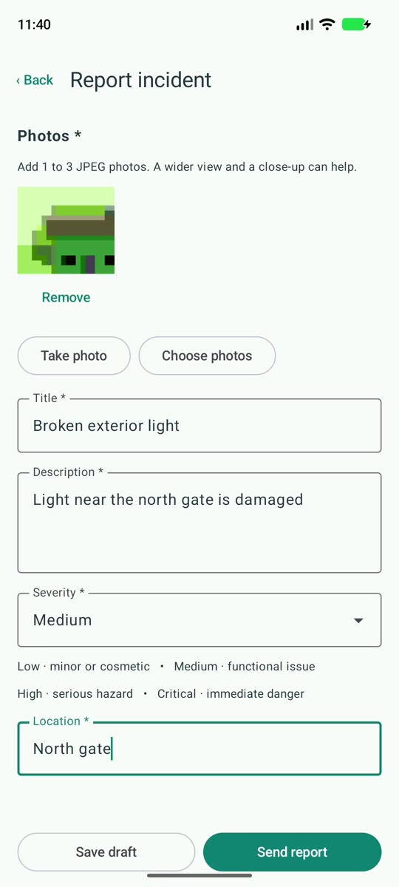
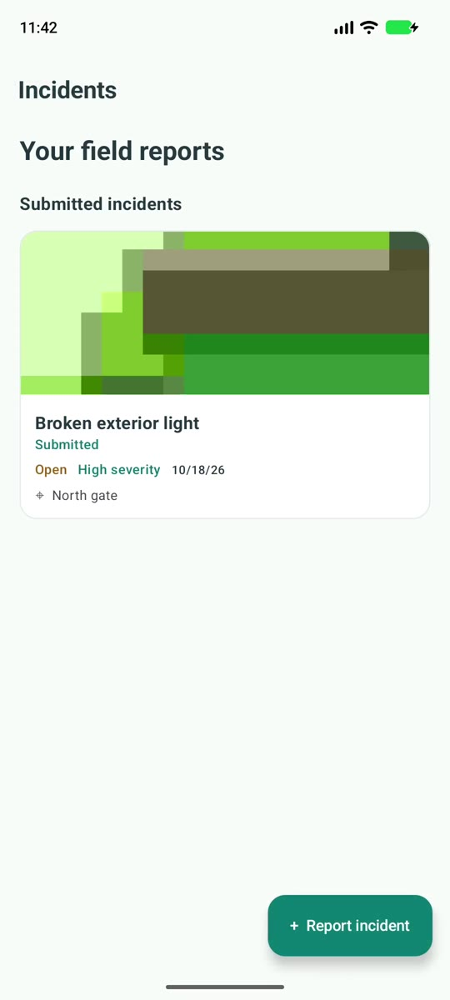
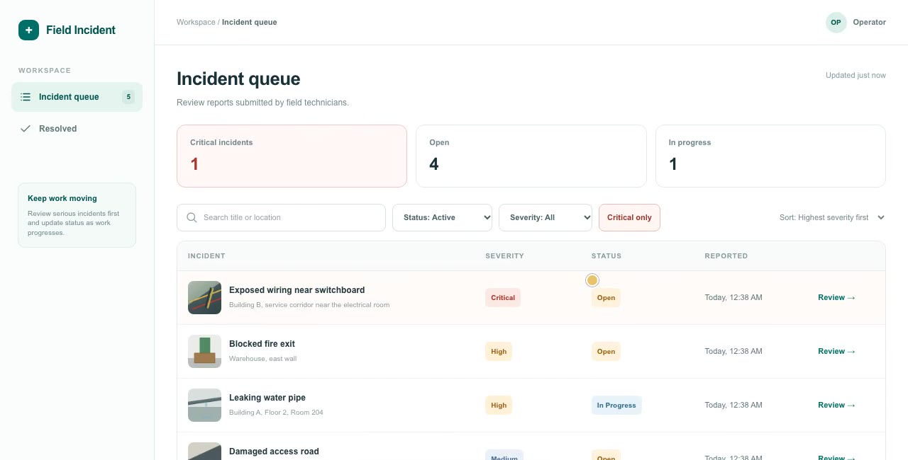
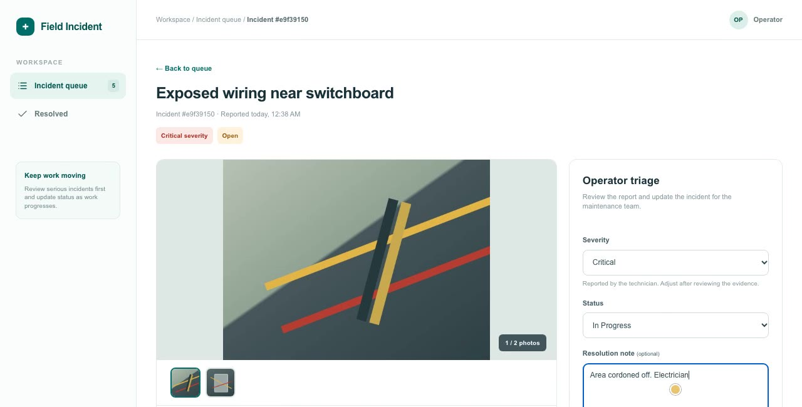

# 🚨 Field Incident Reporter

Field Incident Reporter lets a field technician photograph an incident, enter its details, and send it to a local API. Technicians can view, edit, and delete submitted reports. An operator can review and triage them in the web dashboard.

## 🎬 Demo videos

- [Android app demo](docs/demo/field-incident-demo.mp4)
- [Web dashboard demo](docs/demo/web-dashboard-demo.mp4)

## ✨ Features

### 📱 Android app

- **Capture incidents:** Add a title, description, severity, location, and one to three photos from the camera or photo picker.
- **Save drafts:** Keep a report on the device and send it later, or retry a submission whose result could not be confirmed.
- **Manage reports:** View, edit, and delete submitted incidents.

| Report an incident | View submitted reports |
| :---: | :---: |
|  |  |

### 🖥️ Operator dashboard

- **Find what matters:** Search, filter, and sort a queue that refreshes every 15 seconds.
- **Review and resolve:** Inspect photos and details, then update severity, status, and the resolution note.

| Incident queue | Operator triage |
| :---: | :---: |
|  |  |

## 🚀 Run locally

### Run the API server

Start the API with Node.js 22.12 or later:

```sh
cd server
npm install
npm start
```

The API runs at `http://localhost:3000`. Its request and response formats are documented in [server/API.md](server/API.md).

### Connect the emulator to the local API

To run the Android app, open `android/` in Android Studio and start an emulator. In a terminal, connect the emulator to the local API:

```sh
adb reverse tcp:3000 tcp:3000
```

Then run the debug app from Android Studio. Its default API URL is `http://127.0.0.1:3000/`. For another setup, pass a Gradle property such as `-PapiBaseUrl=http://YOUR_HOST:3000/`.

### Run the web dashboard

To start the operator dashboard in a separate terminal:

```sh
cd web
npm install
npm run dev
```

Open `http://localhost:3001`. Set `API_BASE_URL` if the API is running somewhere other than `http://localhost:3000`.

## 🧪 Tests

```sh
cd server && npm test
cd android && ./gradlew :app:testDebugUnitTest :app:assembleDebug
cd web && npm test
cd web && npx playwright install chromium && npm run test:e2e
```

The browser tests start their own API and dashboard with temporary data.
